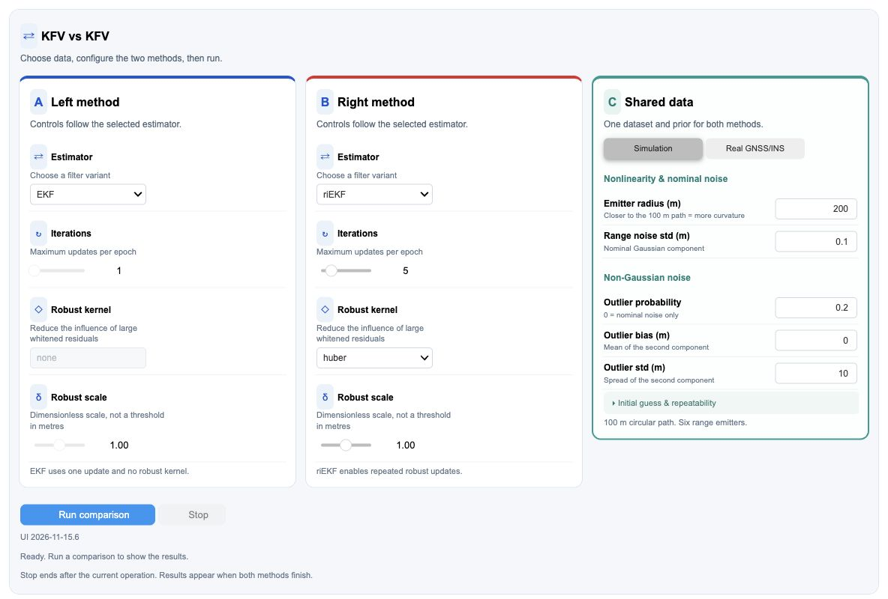
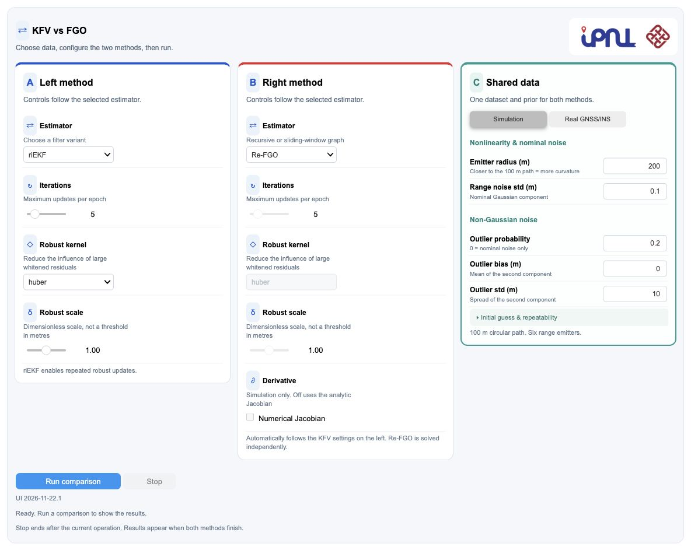
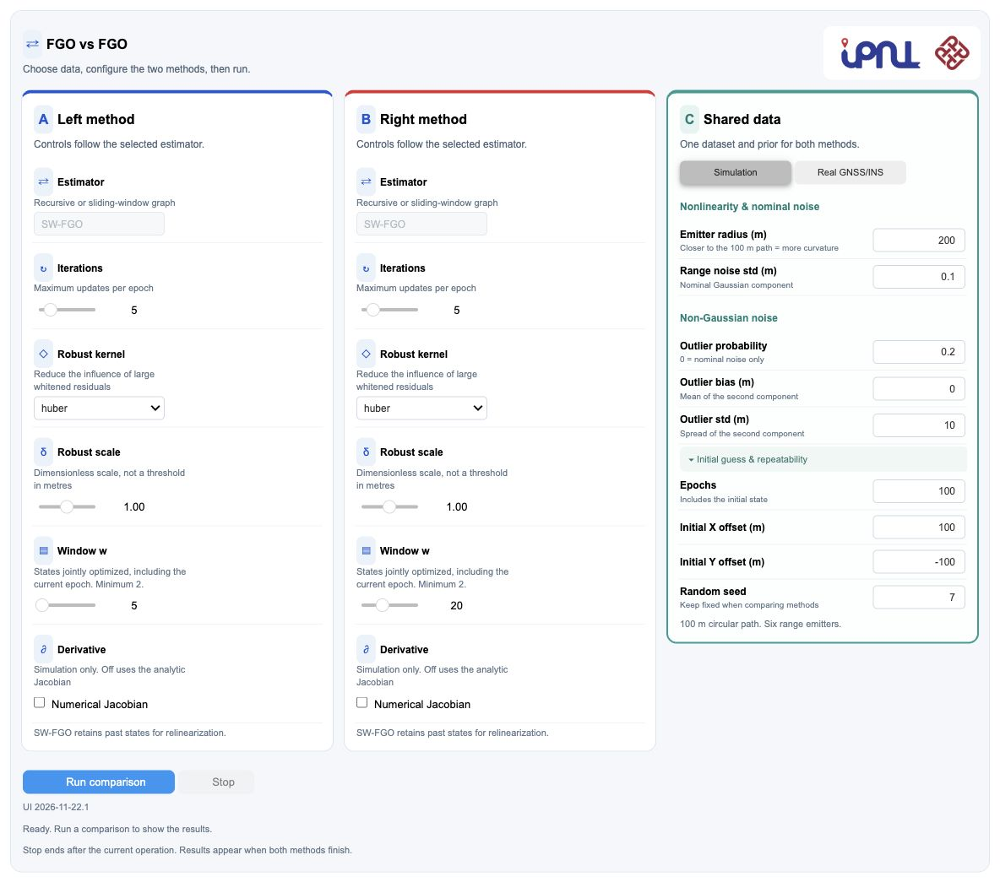
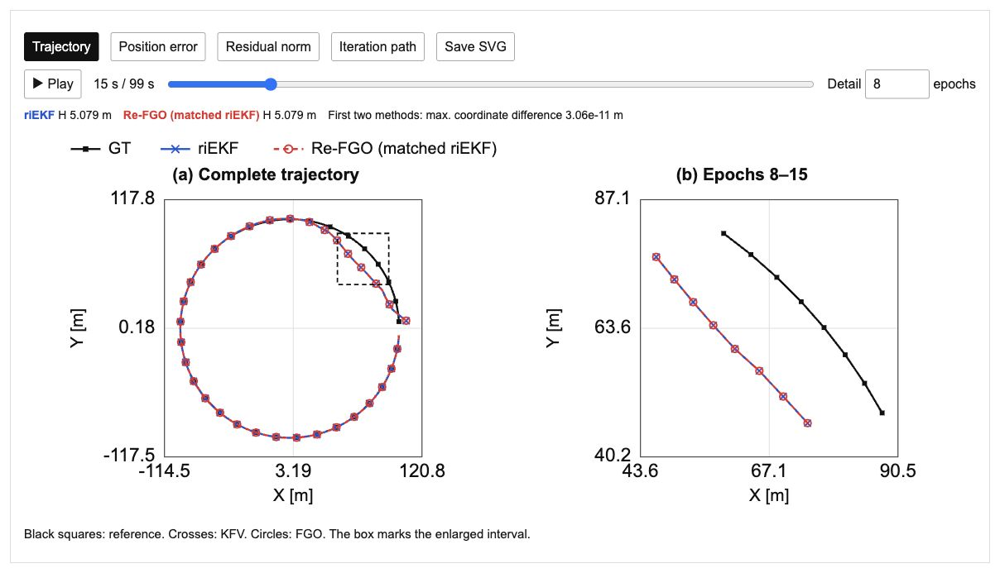
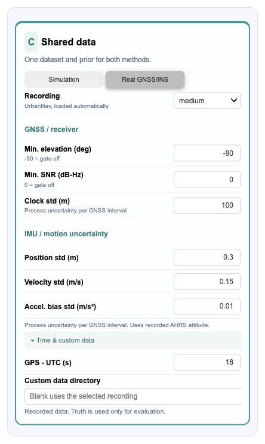

# KFV–FGO Comparison

[**Intelligent Positioning and Navigation Laboratory (IPNL)**](https://www.polyu.edu.hk/aae/ipn-lab/us/en/) [The Hong Kong Polytechnic University (PolyU)](https://www.polyu.edu.hk/)

 

Compare Kalman filter variants and factor graph optimization in your browser. **No local installation.**

### Supporting papers

1. B. Song, R. Xu, Z. Zhan, and L.-T. Hsu. [**Degeneration of sliding-window factor graph optimization into iterated extended Kalman filtering**](https://doi.org/10.1038/s44459-026-00069-4). *npj Wireless Technology*, 2, 58, 2026.
2. W. Wen, T. Pfeifer, X. Bai, and L.-T. Hsu. [**Factor graph optimization for GNSS/INS integration: A comparison with the extended Kalman filter**](https://doi.org/10.1002/navi.421). *NAVIGATION*, 68(2), 315–331, 2021.
3. B. Song, R. Xu, and L.-T. Hsu. [**FGO MythBusters: Explaining how Kalman Filter variants achieve the same performance as FGO in navigation applications**](https://arxiv.org/html/2511.00306v1). arXiv:2511.00306v1, 2025, preprint.

Please cite the relevant papers and report the code commit and settings when publishing results. [Software citation](CITATION.cff).

## Start here

[Open Colab](https://colab.research.google.com/github/Baoshan-Song/KFV-FGO-Comparison/blob/main/KFV-FGO-Colab.ipynb) → run **Setup** → run one of the three comparison cells → click **Run comparison**. Simulation defaults are ready to use.

| Module | What you can investigate |
|---|---|
| [KFV vs KFV](#1-kfv-vs-kfv) | Iteration and robust kernels within filtering |
| [KFV vs FGO](#2-kfv-vs-fgo) | Matched filter/graph equivalence or filtering versus smoothing |
| [FGO vs FGO](#3-fgo-vs-fgo) | Sliding-window length and its interaction with robust kernels |

Every workspace has **A — Left method**, **B — Right method**, and **C — Shared data**. Both methods receive the same observations and initial conditions.

## 1. KFV vs KFV

| Estimator | Iterations | Robust kernel |
|---|---|---|
| **EKF** | Fixed at 1 | Fixed at none |
| **iEKF** | Adjustable | Fixed at none |
| **rEKF** | Fixed at 1 | Selectable |
| **riEKF** | Adjustable | Selectable |

Try EKF versus iEKF to isolate iteration, or iEKF versus riEKF to examine robustness. Unavailable controls are greyed out and show their effective values.

## 2. KFV vs FGO

| Right-hand estimator | Configuration and purpose |
|---|---|
| **Re-FGO** | Automatically matches the left filter. Linked controls are locked. Compare independently computed solutions under matched settings. |
| **SW-FGO** | Configure iterations, kernel and window independently. Examine the effect of retaining past states for relinearization. |

Re-FGO performs two QR marginalizations. Its result is computed by the graph solver. The screenshot shows riEKF matched with robust Re-FGO.

## 3. FGO vs FGO

Both sides use **SW-FGO**, initially with windows of **5** and **20**. Keep the other settings equal to isolate window length, then change the kernel to study their interaction. A larger window does not guarantee lower error.

## A / B — Method options

| Option | What it controls |
|---|---|
| **Estimator** | Filter variant, Re-FGO or SW-FGO, depending on the module |
| **Iterations** | Maximum nonlinear updates per epoch; more iterations reuse the same measurements |
| **Robust kernel** | `none`, `huber`, `cauchy` or `tukey`, applied to whitened measurement residuals |
| **Robust scale** | Dimensionless kernel scale; smaller values downweight residuals more strongly |
| **Gradual scale** | Cauchy/Tukey initialization with a broad scale that approaches the target across iterations; off uses a fixed scale |
| **Window** | Number of states retained after an SW-FGO solve; larger windows retain more history and cost more computation |
| **Numerical Jacobian** | Simulation graph option. Off uses analytic derivatives; on uses central finite differences |

## C — Simulation settings

A **100 m circular trajectory** is observed by **six range emitters**. Measurement noise mixes a nominal zero-mean Gaussian with a second Gaussian controlled by the outlier settings.

| Option | Default | What it changes |
|---|---:|---|
| **Emitter radius (m)** | 200 | Range geometry; moving emitters closer to the path increases local curvature |
| **Range noise std (m)** | 0.1 | Nominal measurement noise and its assumed standard deviation |
| **Outlier probability** | 0.2 | Probability of sampling the second Gaussian; 0 gives nominal noise only |
| **Outlier bias (m)** | 0 | Mean of the second Gaussian |
| **Outlier std (m)** | 10 | Standard deviation of the second Gaussian |
| **Epochs** | 100 | Number of states around the circle, including the initial state |
| **Initial X / Y offset (m)** | 100 / −100 | Shared starting-position error |
| **Random seed** | 7 | Repeatable observations; keep fixed when comparing configurations |

The last three rows are under **Initial guess & repeatability**. Compare Gaussian noise, a zero-mean mixture and a biased mixture by changing only the outlier settings.

## Read the results

**Blue** is the left method, **red** the right method, and **black** the reference. Filter crosses and graph circles overlap when their solutions agree.

| View / control | What you can inspect |
|---|---|
| **Trajectory** | Complete path and a local enlargement |
| **Position error** | Accuracy over time and within the selected detail |
| **Residual norm / Range view** | Post-fit residual, innovation, or simulated truth measurement error; these are not positioning errors |
| **Axis** | Linear or logarithmic residual display |
| **Iteration path / Iteration view** | Updates within an epoch, with range residual norm or full objective |
| **Play / timeline / Detail** | Replay or inspect completed results without rerunning |
| **Save SVG** | Export the displayed vector figure |

The status shows computation progress. **Stop** takes effect after the current operation. The interactive viewer appears when the pair finishes. Accuracy statistics exclude the initial prior and use each method's online estimates.

## Code and credits

[Python / Colab](https://github.com/Baoshan-Song/KFV-FGO-Comparison/tree/main) · [Original MATLAB branch](https://github.com/Baoshan-Song/KFV-FGO-Comparison/tree/matlab) · [Theory and QR conventions](docs/paper_alignment.md)

Thanks to **ZzPolyU** for the GNSS/INS contribution in [PR #5](https://github.com/Baoshan-Song/KFV-FGO-Comparison/pull/5). [Third-party notices](kfv_fgo/THIRD_PARTY_NOTICES.md).

## Bonus — Real GNSS/INS

Choose **Real GNSS/INS** in card C of any module. The method controls and result viewer work as above. Only the data-specific settings change.

Show real-data settings and explanation

| Option | Meaning |
|---|---|
| **Recording** | Bundled UrbanNav `medium`, `deep` or `harsh`; loads automatically |
| **Min. elevation (deg)** | Elevation cutoff; −90 disables it |
| **Min. SNR (dB-Hz)** | Signal-strength cutoff; 0 disables it |
| **Clock std (m)** | Receiver-clock process uncertainty; default 100 |
| **Position std (m)** | Position process uncertainty; default 0.30 |
| **Velocity std (m/s)** | Velocity process uncertainty; default 0.15 |
| **Accel. bias std (m/s²)** | Accelerometer-bias process uncertainty; default 0.01 |
| **GPS − UTC (s)** | Time-system offset; 18 for the bundled recordings |
| **Custom data directory** | Leave blank for bundled data, or supply a directory accessible to Colab |
| **Use saved results** | Loads an exact matching completed run; uncheck to calculate again |

The process standard deviations apply **per GNSS interval**, rather than being continuous IMU noise densities. The model combines pseudorange and IMU measurements using recorded AHRS attitude. Reference positions are used only for evaluation.

Custom data needs `f9p_navi.obs`, `brdm.rnx`, and `xsens_imu.csv` or `xsens_imu.npz`. Optional `gt.txt` enables error plots. The **Error** selector adds horizontal, signed Up and 3D views. **Scene 1 / 2 enlargements** adds medium-recording details. Completed real runs save data under `artifacts/colab/`; download it from Colab's Files panel before the session expires.

## License

This project is licensed under the **GNU General Public License v3.0 (GPLv3)**. See [LICENSE](kfv_fgo/LICENSE) for the full terms.
